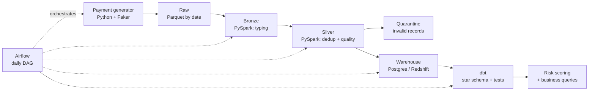

# Payments Data Pipeline

> 🚧 **Status: in progress** — built module by module as a deliberate-practice project. See [`LEARNING_PLAN.md`](LEARNING_PLAN.md).

End-to-end batch data pipeline over synthetic payment transactions. It generates daily payment data, processes it with PySpark through medallion layers (raw → bronze → silver), orchestrates the flow with Airflow, models a star schema in a data warehouse with dbt, and adds a risk-scoring layer on top. It runs locally with Docker first, then on AWS (S3 + Redshift).

**Why payments:** it is the domain where I have production experience (payment platforms and gateway integrations with PlacetoPay / Evertec), so the pipeline is designed around real business questions: approval rates, merchant volume, and suspicious activity.

## Architecture



## Tech stack

| Layer | Tool |
|---|---|
| Language | Python |
| Processing | Apache Spark (PySpark) |
| Orchestration | Apache Airflow |
| Transformation | dbt |
| Warehouse | PostgreSQL (local) · Amazon Redshift (cloud) |
| Storage | Local Parquet · Amazon S3 |
| Containers | Docker / Docker Compose |
| CI | GitHub Actions (ruff + pytest) |
| Risk scoring | Pandas · Scikit-learn |

## Repository structure

```
ingestion/      Synthetic payment generator → raw layer          (Module 1)
spark/jobs/     PySpark jobs: raw → bronze → silver              (Module 2)
airflow/dags/   Daily orchestration DAG                          (Module 3)
dbt/            Staging and marts models + data tests            (Module 4)
analysis/       Business questions in SQL                        (Module 4)
infra/          Docker and cloud infrastructure                  (Modules 0, 5)
tests/          Unit tests                                       (Modules 2, 6)
docs/           Decisions log, data contract, architecture, evidence
```

## How to run

_Coming in Module 0: `make up` will start the full local stack._

## Results

_Real metrics (rows processed, runtime, data-quality results) will be added as modules are completed._

## What I would do differently in production

_Written at the end of the project._
