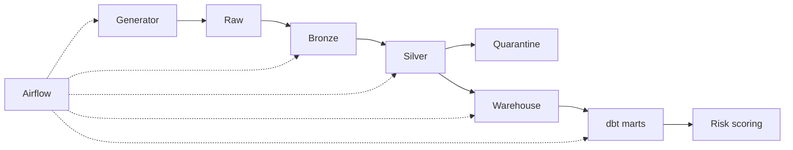

# Arquitectura

> Actualiza este documento cuando una decisión cambie el diseño. Cada capa debe tener una razón de existir.

## Capas

| Capa | Qué contiene | Quién la escribe | Por qué existe |
|---|---|---|---|
| Raw | | | |
| Bronze | | | |
| Silver | | | |
| Cuarentena | | | |
| Warehouse (staging) | | | |
| Marts (gold) | | | |

## Local vs. nube (Módulo 5)

| Componente | Local | AWS |
|---|---|---|
| Almacenamiento | Parquet en disco | S3 |
| Procesamiento | Spark en Docker | |
| Warehouse | Postgres | Redshift Serverless |
| Orquestación | Airflow en Docker | |
